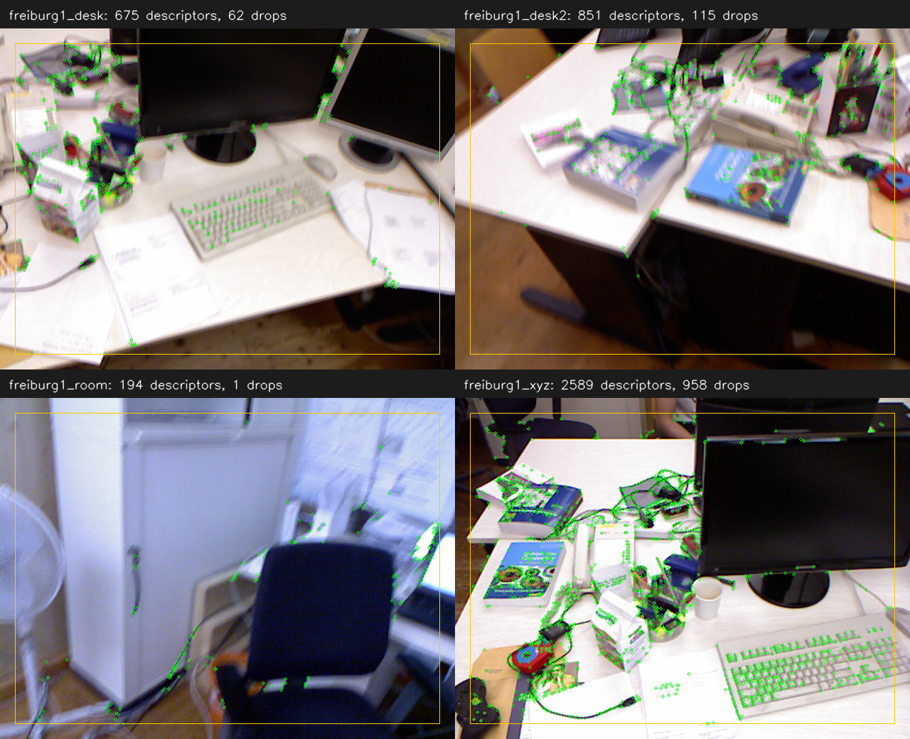

# ORB image regression - 2026-11-24

All four original TUM RGB-D images passed at native 640x480 resolution. Each was streamed twice, at FAST thresholds 20 and 40, through the full three-BRIEF ORB level. RTL revision: `5e50252`; only test scripts/testbench changed for this run.

| Sequence | FAST at 20 | FAST at 40 | FIFO-admitted | Descriptors checked | Dispatch drops | Engine 0 / 1 / 2 | Input gaps |
|---|---:|---:|---:|---:|---:|---|---|
| freiburg1_desk | 663 | 160 | 737 | 675 | 62 | 395 / 193 / 87 | None |
| freiburg1_desk2 | 853 | 178 | 966 | 851 | 115 | 505 / 233 / 113 | Random 0-3 extra clocks |
| freiburg1_room | 187 | 24 | 195 | 194 | 1 | 153 / 32 / 9 | None |
| freiburg1_xyz | 2473 | 1135 | 3547 | 2589 | 958 | 1240 / 804 / 545 | Random 0-3 extra clocks |

Counts are totals over both threshold passes except the two FAST columns. FAST totals include points excluded by the 21-pixel descriptor border. Dispatch drops combine stale FIFO heads and matches with all engines busy; these causes were not counted separately. All FIFO-admitted points are accounted for as completed descriptors or dispatch drops. No FIFO overflow occurred.

## Coverage

- 5,673 FAST keypoints matched both OpenCV FAST and an independent NumPy FAST reference, including coordinates and scores under the existing border/score conventions.
- 2,095,392 orientation results matched direct Gaussian/moment references, including quadrant, sector, signed sine/cosine, validity, and coordinate latency.
- 4,309 descriptors (1,103,104 bits) matched the reference with metadata and exact 259-clock completion checks.
- Verified all three BRIEF engines, fixed-priority selection, FIFO order, patch freeze/alignment, valid gaps, two frame passes, and initial partial-frame recovery.
- Gaussian reference uses the exact integer binomial kernel and truncation. Cached reference files accelerate full-resolution checks; sampled direct integer convolutions/moments cross-check the vectorized calculations.
- Every descriptor comparison uses the selected fixed pattern, reference blurred pixels truncated to six bits, signed fixed-point rotation, and the current greater-than comparison convention.

## Images

Green marks are positions that produced descriptors in either threshold pass. Yellow rectangles mark the valid center region (21-pixel border). Overlapping positions from the two passes can appear only once visually.



## Sources and selection

Side-by-side comparisons (hardware left, software right): [threshold 20](2026-11-24-tum/hardware-vs-software-t20.png), [threshold 40](2026-11-24-tum/hardware-vs-software-t40.png). The software side shows OpenCV FAST/NMS candidates with the same 21-pixel border and no dispatch capacity limit, not standard OpenCV ORB descriptors. Green points have hardware descriptors; orange points are software candidates absent from the hardware descriptor stream. These are spatial keypoint comparisons; descriptor bits were checked separately by the regression. Per-threshold hardware records are separated at their single raster-coordinate wrap between the two fixed-latency passes. Recreate with `python -B orb_hardware/scripts/tum_compare.py`.

These four sequences appear in Table 4 of [the referenced paper](https://arxiv.org/html/2207.08405v1#S5.SS3). Images came from the [official TUM RGB-D dataset](https://webshare.cvg.cit.tum.de/g/rgbd/dataset/). The first RGB PNG encountered in each archive was selected; archive order is not necessarily chronological. No resizing, cropping, or undistortion was applied. RGB was converted to 8-bit grayscale with OpenCV BGR2GRAY.

- [freiburg1_desk](https://webshare.cvg.cit.tum.de/g/rgbd/dataset/freiburg1/rgbd_dataset_freiburg1_desk.tgz): `rgbd_dataset_freiburg1_desk/rgb/1305031469.595755.png`
- [freiburg1_desk2](https://webshare.cvg.cit.tum.de/g/rgbd/dataset/freiburg1/rgbd_dataset_freiburg1_desk2.tgz): `rgbd_dataset_freiburg1_desk2/rgb/1305031539.275652.png`
- [freiburg1_room](https://webshare.cvg.cit.tum.de/g/rgbd/dataset/freiburg1/rgbd_dataset_freiburg1_room.tgz): `rgbd_dataset_freiburg1_room/rgb/1305031929.033640.png`
- [freiburg1_xyz](https://webshare.cvg.cit.tum.de/g/rgbd/dataset/freiburg1/rgbd_dataset_freiburg1_xyz.tgz): `rgbd_dataset_freiburg1_xyz/rgb/1305031107.143260.png`

Exact image hashes, source URLs, counts, and grayscale hashes are saved in [results.json](2026-11-24-tum/results.json). Per-case simulator logs, keypoint lists, and descriptor records are preserved alongside it. Original RGB files and simulation workspaces remain under the ignored `orb_test_output/` folder.

## Scope

This establishes bit-level agreement with this RTL design, not standard OpenCV ORB descriptor compatibility or SLAM trajectory accuracy. BRIEF uses a custom pattern and the implemented quantized orientation. Only four still images were tested (each repeated at two thresholds), not complete moving sequences. Dispatch-drop rates depend on image content, threshold, and valid-gap schedule. No RTL was changed and no synthesis was rerun.

## Reproduce

```powershell
python -B orb_hardware/scripts/tum_fetch.py
python -B orb_hardware/scripts/tum_check.py
```

The fetcher streams official archives and stops after saving one RGB member, avoiding full dataset downloads. The runner requires Vivado 2024.1, Python, NumPy, and OpenCV.
