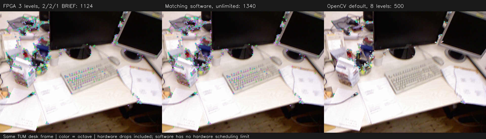

# Same-frame hardware/software comparison

TUM Freiburg1 desk, 640x480. Run compare_frame_software.py.

| Metric | FPGA 2/2/1 | Matching software | OpenCV ORB defaults |
|---|---:|---:|---:|
| Pyramid levels | 3 | 3 | 8 |
| Descriptors | 1,124 | 1,340 | 500 |
| Octave 0 | 521 | 594 | 109 |
| Octave 1 | 373 | 407 | 90 |
| Octave 2 | 230 | 339 | 75 |
| Octaves 3–7 | — | — | 226 |

All 1,124 hardware coordinates occur in the matching reference; all angles
and descriptors match exactly (mean Hamming distance zero). Hardware retains
83.88% of its 1,340 software candidates. Missing counts are 73, 34 and 109 by
octave. The prior simulation reported BRIEF drops in every octave and no FIFO
or network overflow. There are no hardware-only coordinates.

The software arithmetic model uses the same origin-aligned 5/6 bilinear pyramid,
FAST threshold 20 and strict NMS, 21-pixel border, binomial blur, 37x37 moments,
15 Q8 tangent thresholds, Q7 trig table, 6-bit BRIEF pixels, custom 256-pair
pattern and integer rotation. It evaluates every candidate without engine
availability limits. Software has no intrinsic BRIEF-engine count: 2/2/1 is a
hardware scheduling constraint. At the actual hardware-admitted coordinates,
software produces exactly the same 1,124 descriptors.

OpenCV 4.13.0 ORB_create() defaults: eight levels, 1.2 scale factor,
500-feature cap, Harris ranking, edgeThreshold 31, patchSize 31, FAST threshold
20 and OpenCV's own descriptor pattern. Its descriptors are therefore not
bitwise comparable with this custom implementation. It is a separate standard
baseline, not the reference used for the exact-descriptor agreement above.
Defaults: https://docs.opencv.org/4.x/db/d95/classcv_1_1ORB.html

Timing context only: hardware simulation spans 26.985 ms including camera input,
Ethernet output and a fixed 2 ms final wait. Python arithmetic model took
231.237 ms for one run. Optimized OpenCV median is 7.151 ms over 30 warmed runs
with one CPU thread. These measure different workloads and implementations;
they do not establish an FPGA speedup. XSim wall time is not hardware latency.

Full measurements are in results.json. Images show feature locations mapped
to original-image coordinates, with octave encoded by color.
